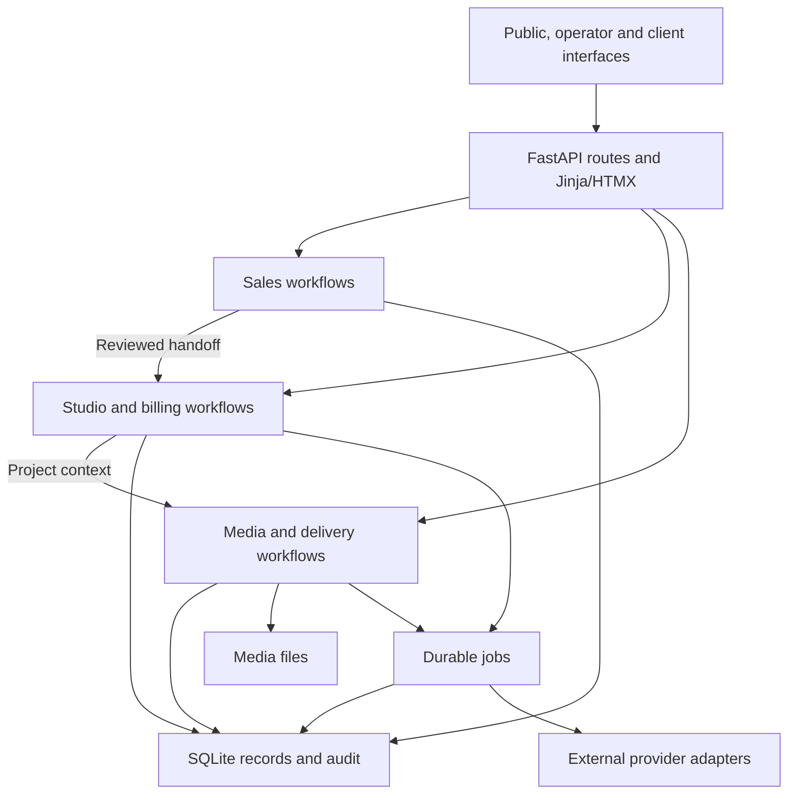

# KleePhotography / Mise — architecture and implementation roadmap

Prepared for Kevin · 12 November 2026 · planning timezone: America/New_York

**Recommendation:** evolve Mise as a modular monolith: one deployable application, with clear ownership of sales, studio operations, payments and delivery. Keep the current FastAPI, Jinja/HTMX, vanilla JavaScript, SQLite/WAL and durable jobs foundation. Make the next changes improve the daily photography sales loop while gradually moving business rules out of HTTP route files.

Kevin approved this direction for incremental implementation on 12 November 2026. This document is the in-repository roadmap; implement and verify one bounded change at a time. Deployment, provider activation, client communication and payment changes remain separately reviewed work.

## Implementation status

- **Implemented in #166:** shared sales values/validation/identity rules in `app/sales/rules.py` and review-return navigation in `app/admin/prospect_context.py`. All prospect routes use these shared owners. Drafts and preferences no longer import the follow-up router; handoffs no longer import the capture router.
- **Implemented in this slice:** `commands.change_followup` validates and commits a standalone complete/reschedule/cancel command with its audit record. Contact and handoff workflows reuse `commands.apply_task_change` on their existing transaction connections; handoff no longer imports the follow-up router. Scheduling/contact/draft/handoff orchestration and capture’s `prospect_followups.detail_context` remain incremental follow-on work.
- **Then:** full handoff browser coverage, followed by a bounded outbound outcome report. Operational readiness is a separate track before deployment; AI remains conditional on a demonstrated operator need.

The verified starting point below is historical evidence from before this extraction. Current PR checks and the implementation notes in [SOLO-SALES.md](SOLO-SALES.md#transactional-follow-up-command) record the current command slice’s verification.

## 1. Verified starting point

Reviewed main commit [`1a21412`](https://github.com/Ayyitskevin/kleephotography/commit/1a21412a1d2b0636d7e73d223927bf7e1dd96034), after Kevin merged PR #165. Its tree matches the tested candidate. Post-merge [CI](https://github.com/Ayyitskevin/kleephotography/actions/runs/43256484183) and [CodeQL](https://github.com/Ayyitskevin/kleephotography/actions/runs/43256484251) passed. The implementation session verified 504 unit, 1,308 integration, 188 smoke and 66 JavaScript cases. Hosted Chromium passed eight desktop/mobile journeys and 26 axe scans reported no automated violations. Inconclusive accessibility findings and full screen-reader/other-browser assessment remain separate.

The code already provides prospect capture, duplicate review, dated tasks, manual contact history, contextual message drafts, reviewed client/project handoff, outreach restrictions, guided review and keyboard navigation. Studio proposals/contracts/invoices, bookings, delivery galleries, retainers, attribution and several reminder/reporting functions also exist. These are foundations to reuse.

Repository evidence does not establish which version is running on Flow, which integrations are enabled, whether off-host backups are armed, or the current production workload. Those require an authorized operational check.

## 2. Product shape

Mise should let Kevin answer four questions quickly: who needs attention, what evidence supports the next action, what happened, and what should happen next. The sales workbench remains the front door to outbound work. Confirmed interest leads through the existing explicit handoff into the studio, where established proposal, contract, payment, shoot and delivery workflows take over.

Three audiences share the same application:

| Surface | Responsibility | Primary boundary |
| --- | --- | --- |
| Public website | Portfolio, services and inquiry/booking intake | Public input is validated before it becomes business data |
| Kevin's workbench | Research, manual sales activity, studio operations and reporting | Authenticated commands with explicit outcomes |
| Client experience | Documents, booking/payment and delivery | Existing document, payment and gallery access controls |

Salty-inspired workflow ideas remain useful: preserve account context, explain queue eligibility and make the next action obvious. Photography terminology and the existing studio lifecycle remain authoritative.

## 3. Target application architecture

The diagram shows responsibility boundaries inside one application. It is not a proposal for separate services.

The picture is deliberately simplified: synchronous provider operations and inbound callbacks already exist. Any later movement of those operations into jobs requires its own behavioral review.

| Boundary | Existing implementation | Intended direction |
| --- | --- | --- |
| HTTP and presentation | `app/admin/prospect_*.py`, `prospects.py`, templates and static files | Parse requests, authenticate, check CSRF, verify signed input, invoke a workflow, render/redirect |
| Sales rules and commands | Shared rules in `app/sales/rules.py`; follow-up changes in `app/sales/commands.py`; remaining workflow orchestration in routes | Small `app/sales/` modules with explicit callable interfaces; extract only code with actual shared use |
| Outreach policy | `app/outreach.py` | Retain one policy owner and conservative aggregation across explicit client links |
| Studio and billing | Existing studio, proposals, contracts, invoices and public payment modules | Keep financial/legal invariants behind their existing reviewed boundaries |
| Data and audit | `app/db.py`, numbered migrations, `app/audit.py` | Explicit SQL, transactions, version checks and audit records; no generic repository framework |
| Background work | `app/jobs.py`, scheduler and existing handlers | Reuse durable jobs, retries and health reporting; measure contention before separating worker processes |
| Integrations | Existing mail, SMS, calendar, Notion and machine API modules | External results enter through validated adapters, with narrow credentials and clear provenance |

The starting maintainability issue was shared private helpers: drafts, handoffs and preferences imported validation from the follow-up router, and handoffs imported identity helpers from capture. The first slice separates those rules and review navigation. The second slice extracts the standalone follow-up command and shared task transition. Queue/detail reads and other workflow orchestration remain in routes until their own behavior-preserving extractions; a future API or assistant should consume those explicit shared boundaries.

A gradual code layout is appropriate:

- `app/sales/rules.py`: shared validation, identity normalization and domain errors used by multiple workflows.
- `app/sales/commands.py`: explicit operations such as schedule, record contact, change next action and save draft; extract one coherent workflow at a time.
- `app/sales/queries.py`: reusable, read-only queue/detail/report projections once there are multiple consumers.
- `app/admin/prospect_context.py`: validated request navigation context and fixed local return destinations. This is presentation logic, not a business rule.
- `app/outreach.py`: stays the shared outreach policy owner.

`rules.py`, the first `commands.py` use case and `prospect_context.py` are implemented; additional commands and shared queries should be extracted only as their actual consumers need them. Routes should depend on shared logic; shared logic should not import route modules. Keep existing URLs, form fields, token payloads and rendering behavior stable during extraction.

## 4. Data ownership and truthful state

| Record | What it means | Relationship to preserve |
| --- | --- | --- |
| Prospect | Researched business/contact and qualification | Remains distinct from an inbound inquiry or a booked client |
| Task | A dated obligation | Prospect tasks have one open next action, explicit ownership and historical completed/canceled rows |
| Contact event | What Kevin records as having happened | Retains occurrence date, recording time and manual provenance |
| Message draft | Prepared text and its context snapshot | Copying or saving does not record sending, delivery or a reply |
| Outreach preferences | Explicit restrictions and advisory channel preference | No recorded restriction is not consent; linked restrictions combine conservatively |
| Handoff | Reviewed bridge from one prospect to a client/project | Preserve research snapshot and task disposition; later shoots use the client's normal project controls |
| Client/project | Relationship and a photography opportunity/job | Existing project workflow owns stage changes and downstream documents |
| Payments and invoices | Financial facts under existing payment rules | Reports derive collected cash from the existing payment authority |

Do not infer client identity from similar names, merge historical records automatically, or create a second task store. The existing handoff may reuse a client/project without overwriting it. Contact history stays attached to its prospect and is linked from the studio.

For a write command, preserve this order: validate input and authorization; open one transaction; reload current records and applicable policy; verify versions, scoped review tokens and retry keys; write the requested changes and audit together; commit; then dispatch any jobs that were staged in that transaction. Nested helpers receive the connection instead of committing independently. External network work should not extend these sales transactions.

Preserve the existing distinction between historical recording and initiating new outreach: recording a contact that already happened is allowed under a hold; preparing new outreach has additional restrictions. Current sales holds do not automatically govern every Inbox, announcement or client-service sender. Any future sending feature must explicitly define its communication class and policy enforcement at execution time.

Continue using the studio clock for day-level decisions. Today it follows the host's local date. Before production rollout, verify the host timezone is America/New_York; any later extraction into a shared clock must preserve existing boundaries and test hooks. Store event timestamps consistently, and explicitly distinguish occurrence date from recording date in reports.

## 5. Infrastructure and device roles

| Component | Proposed role |
| --- | --- |
| Flow | Canonical app origin, local SQLite database, durable jobs and media, following Kevin's stated hosting layout |
| Mickey | Optional research/draft inference through a bounded API; no direct database or media-directory write access |
| NAS | Backup/media copy according to the existing recovery runbooks; not a shared live SQLite volume |
| Highwind | Editing and content production, outside the application's availability dependency |

Retain one app/scheduler owner for now. App startup launches jobs and the recurring scheduler, so simply adding web worker processes is not a safe scaling strategy. Before separating workers, define startup ownership, job claim/recovery behavior and scheduler leadership.

SQLite remains a sensible starting point for this single-host application. It permits many readers but serializes writers; WAL depends on same-host coordination. Keep transactions short and the live database local. If multiple machines must write directly or measured lock contention persists after query/transaction fixes, evaluate PostgreSQL with a dedicated migration plan. [SQLite guidance](https://www.sqlite.org/whentouse.html), [WAL constraints](https://www.sqlite.org/wal.html).

Jobs already provide durable staging and retries. Existing side effects are generally at least once, with per-path idempotency protections; do not promise exactly-once external delivery. Inspect existing queue health and measure media-job delays before adding a separate broker or worker service.

Operational readiness is a parallel track before any deployment: verify the running version, external health monitoring, scheduler/backup heartbeats, off-host backup configuration, credentials recovery and a disposable restore. Use the existing `MONITORING.md` and `DR.md` procedures. Their presence in git is not evidence that they are operational. Recovery targets should be accepted only after measuring a restore of representative database and media data.

## 6. Delivery sequence

Scopes 1 and the first use case of 2 are implemented. Later rows and additional command extractions are planned PR scopes, not calendar commitments. Each should be independently reviewable and retain the required local and hosted gates.

| Order | Bounded change | Acceptance evidence |
| --- | --- | --- |
| 1 | Extract the genuinely shared sales validators/errors and review-navigation context from route modules | Existing routes, tokens, errors, retry behavior and eight browser journeys remain unchanged; targeted imports use explicit shared interfaces |
| 2 | Move one transactional sales use case into an explicit command boundary, then extend incrementally | One transaction owns mutation plus audit; stale versions, exact retries, audit rollback and hold races retain their existing outcomes |
| 3 | Cover the full draft/contact/opportunity handoff in the hosted browser suite; add only observed navigation gaps | New/existing client choices, pending-task disposition, stale handoff review, duplicate submission and return navigation work without creating documents or sending messages |
| 4 | Add a focused outbound outcomes section to the existing Reports surface | Counts reconcile to source records; date basis and manual provenance are visible; duplicate joins cannot inflate opportunities or cash |
| Parallel | Verify operational readiness and isolate dependency maintenance | Restore evidence and monitoring checks before deployment; Stripe PR #164 gets a separate SDK/API compatibility and lockfile pass |
| Conditional | Introduce assisted research/drafting after operator usage identifies a worthwhile gap | Bounded context, provenance, stale-context rejection, manual acceptance, timeouts and deterministic fallback |

The first slice extracts helpers reused across existing sales modules and moves request navigation context to its own presentation module, without schema, provider or user-visible changes. The second slice moves follow-up changes into a command that owns its transaction, with the shared task transition joining contact/handoff transactions. Additional orchestration can follow incrementally without changing these contracts.

Before committing to more features, Kevin should exercise a short representative pilot: capture, draft, manual contact, next action, confirmed opportunity and handoff. Record where he repeats research, loses context or has to reconstruct an outcome. Those observations choose the next usability change.

## 7. Reporting that can support business decisions

Extend existing Reports rather than creating another analytics system. Separate current work from historical results:

- Current work: due/upcoming tasks, eligible prospects without a next step, held work and quiet opportunities.
- Recorded activity: manual attempts, explicitly recorded inbound responses and reviewed handoffs within a clearly labeled date window.
- Commercial results: existing project/document facts and collected payments linked through the handoff, deduplicated at project/payment identity.

Do not call queue counts a conversion rate. Define the denominator, cohort and observation window before displaying a funnel percentage. Preserve unknown attribution. A payment linked to a prospect is associated revenue, not proof that a particular message caused the booking. Existing financial reporting keeps its meaning.

Start with existing rows and timestamps. Introduce new schema only when a necessary question cannot be answered honestly from those records. Benchmark queue/report queries with synthetic datasets of increasing size and inspect query plans before choosing indexes or caching; no production performance claim is made here.

## 8. Optional AI boundary

Sales drafts are currently deterministic. Other AI-related adapters and callbacks already exist in the repository; extend narrow patterns only after reviewing their actual contracts. Do not treat the machine API as universally read-only: it also contains authenticated callbacks that mutate related records.

For a future sales assistant, the application constructs a bounded context packet: permitted prospect facts, selected history, existing draft context and effective restrictions. The model returns a suggestion with source references, uncertainties and generation provenance. Treat external research and model output as untrusted data. Reject invented price, availability, consent, booking or delivery claims. Kevin reviews any accepted text through the existing draft workflow.

Re-read policy and context versions at acceptance. A timeout, unavailable Mickey node or rejected output leaves deterministic drafts and ordinary CRM operation available. No model receives general SQL, unrestricted admin sessions or authority to change payment/project states. Sending remains a separate, explicitly authorized feature with recipient, content, policy and retry semantics reviewed independently.

## 9. Quality and change gates

Retain pytest unit/integration/smoke, JavaScript tests, Hypothesis, Ruff, Bandit, CodeQL, dependency audits, secret scanning, migration/lock consistency and hosted Playwright/axe. Add tests for behavior or architectural boundaries that can actually regress; avoid a new framework just to enforce a folder layout.

Extend browser coverage to draft freshness/copy and opportunity handoff; retain keyboard, stale-form and restriction cases. Add a measured manual screen-reader pass and selected other-browser checks before calling the experience broadly accessible. Automated checks cannot establish full accessibility. [Playwright guidance](https://playwright.dev/docs/accessibility-testing).

Schema changes stay additive and forward-only. Older application versions do not necessarily understand prospect task ownership, cancellation or handoff retention, so an application rollback requires compatibility review rather than dropping history. Financial, legal, authentication and deployment changes remain isolated for Kevin's review.

## 10. When to reconsider the architecture

| Evidence | Next architectural decision |
| --- | --- |
| Repeated user-visible database lock failures after shortening transactions and fixing queries | Evaluate PostgreSQL and migration/restore strategy |
| Media work measurably delays interactive requests or important jobs | Separate worker ownership and scheduling, initially within the same codebase |
| Local media capacity, bandwidth or restore time misses an agreed requirement | Evaluate object storage and delivery URLs with an access-control review |
| Real multi-operator demand | Design accounts, roles and audit identity before adding users |
| Measured drafting/research bottleneck with reliable source material | Trial the bounded assistant described above |

None of these thresholds has been established by this repository review. The near-term goal is a dependable solo workbench with shared rules and an observable path from researched prospect to paid photography work.

## Evidence and references

Repository links are pinned to the reviewed main commit:

- [README architecture](https://github.com/Ayyitskevin/kleephotography/blob/1a21412a1d2b0636d7e73d223927bf7e1dd96034/README.md)
- [Solo sales workflow and invariants](https://github.com/Ayyitskevin/kleephotography/blob/1a21412a1d2b0636d7e73d223927bf7e1dd96034/ops/SOLO-SALES.md)
- [Follow-up router and shared helpers](https://github.com/Ayyitskevin/kleephotography/blob/1a21412a1d2b0636d7e73d223927bf7e1dd96034/app/admin/prospect_followups.py)
- [Outreach policy](https://github.com/Ayyitskevin/kleephotography/blob/1a21412a1d2b0636d7e73d223927bf7e1dd96034/app/outreach.py)
- [Handoff schema](https://github.com/Ayyitskevin/kleephotography/blob/1a21412a1d2b0636d7e73d223927bf7e1dd96034/migrations/086_prospect_handoffs.sql)
- [Existing Reports](https://github.com/Ayyitskevin/kleephotography/blob/1a21412a1d2b0636d7e73d223927bf7e1dd96034/app/admin/reports.py)
- [Jobs and delivery contract](https://github.com/Ayyitskevin/kleephotography/blob/1a21412a1d2b0636d7e73d223927bf7e1dd96034/ops/AT-LEAST-ONCE.md)
- [Monitoring](https://github.com/Ayyitskevin/kleephotography/blob/1a21412a1d2b0636d7e73d223927bf7e1dd96034/ops/MONITORING.md) and [disaster recovery](https://github.com/Ayyitskevin/kleephotography/blob/1a21412a1d2b0636d7e73d223927bf7e1dd96034/ops/DR.md)
- [Engineering checks](https://github.com/Ayyitskevin/kleephotography/blob/1a21412a1d2b0636d7e73d223927bf7e1dd96034/ops/ENGINEERING-TOOLS.md)
- [FastAPI application organization](https://fastapi.tiangolo.com/tutorial/bigger-applications/)

The implementation status above distinguishes delivered boundaries from planned work. Remaining module names, sequence and scaling triggers are design recommendations inferred from the code review; they are not claims of deployed capabilities.
