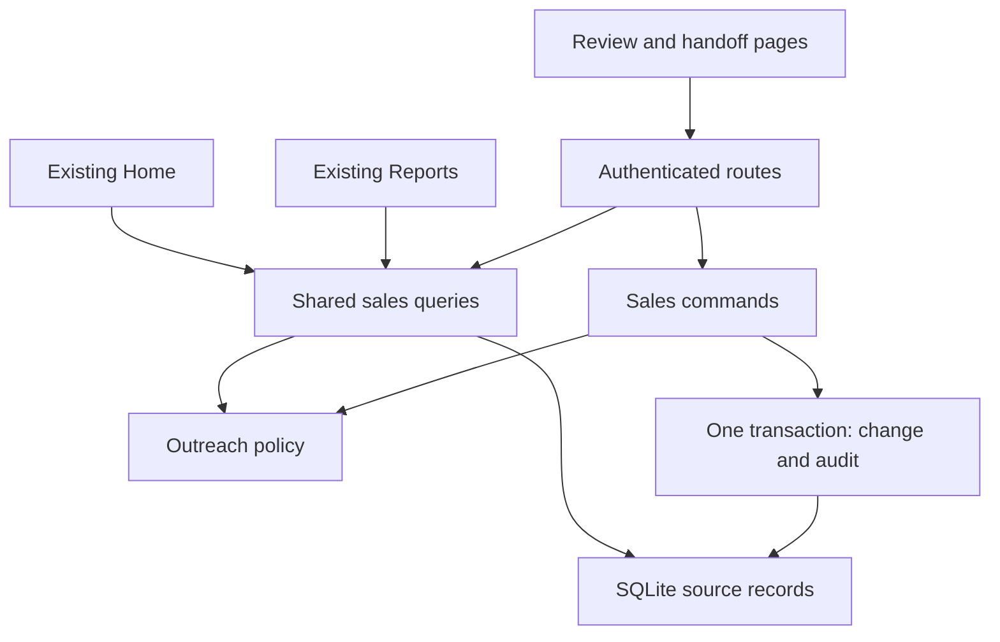

# Sales workbench — product spec and build sequence

Prepared for Kevin · 12 November 2026 · planning timezone: America/New_York

**Status: incremental implementation contract.** S1 (bidirectional review navigation) is implemented in this change; S2–S7 remain planned. This document authorizes no deployment, sending or payment operation. It extends [ARCHITECTURE.md](ARCHITECTURE.md); [SOLO-SALES.md](SOLO-SALES.md) records the implemented behavior and verification.

## 1. Outcome and verified baseline

Make a short photography sales session flow from **choose work → understand context → prepare a message → record what actually happened → choose the next step → review a real opportunity**. Kevin should not have to reconstruct context between those steps. Completion remains a deliberate action, not a side effect of navigation.

Baseline: main `0c9a8f001d709f46dc8e2055daa180499c9dfff5`, after #167. Its post-merge [CI](https://github.com/Ayyitskevin/kleephotography/actions/runs/43311642128) and [CodeQL](https://github.com/Ayyitskevin/kleephotography/actions/runs/43311641989) passed. This is repository evidence, not a statement about the version deployed on Flow.

The following table describes that historical baseline. S1 now adds Previous/Next wraparound, omits self-navigation for a single eligible record and clears a stale position when a hold arrives between queue and detail reads. Handoff continuity is still S2.

| Capability | Current code | Remaining work |
| --- | --- | --- |
| Guided review | Due/upcoming/unplanned queues, forward navigation, live eligibility, explicit changed/empty state | Previous navigation and a direct opportunity-handoff detour with return context |
| Research and preferences | Research notes, duplicate review, holds/channel restrictions, validated return links | Preserve these contracts across the additional detour |
| Contact and tasks | Manual contact events, one pending prospect task, explicit task outcomes and atomic audit | A readable combined history; no new task store |
| Drafts | Grounded starters, review/freshness checks, save/edit/copy; separate tab | Full browser coverage through manual contact and handoff, preserving draft ≠ send |
| Notes | One editable research summary and notes within contact records | Separate append-only observations that do not fabricate contact |
| Home | Ranked On deck cards for invoices, inbound replies, galleries and nudges; separate prospect follow-ups link | Visible due prospect work using the same eligible queue |
| Reports | Financial, inquiry and project reporting | A separate, precisely defined outbound activity/outcomes section |

Client-activity aging, attention indicators, duplicate checks, date shortcuts and the initial shared sales rules/command boundaries already exist. Do not rebuild them. Private cross-project research informed this plan; it contributes general interaction patterns, not copied employer screens, customer records, insurance rules or a change of technology stack.

## 2. Product decisions

1. Keep the FastAPI/Jinja/HTMX/vanilla JavaScript modular monolith and SQLite. Extend existing pages and shared sales boundaries.
2. The workbench's job is to help Kevin decide and record. No automatic outreach, inferred replies, automatic loss/archiving or automatic task completion.
3. Retain separate identities for prospects, clients and projects. A reviewed handoff links them; it does not turn research into a booking.
4. Outreach policy stays in `app/outreach.py`. A recommendation, an expired pause or an available contact field is not consent. Historical recording and internal notes remain distinct from preparing new outreach.
5. Use existing Tasks, contact events, handoffs, drafts and audit records. Only quick notes need a proposed new domain table; do not turn the audit log into an editable notes database.
6. Finish and prove the core journey before adding summaries and analytics. A missing browser check is a delivery gap, not a reason to bypass an existing environment restriction.
7. Each feature ships in a separate reviewed PR. Kevin merges. Schema, financial/legal, auth and deployment boundaries retain their repository rules.

## 3. Architecture and ownership

This shows the sales boundary, not the complete application. Existing studio, billing and delivery modules keep their ownership. No new service, broker, event bus, generic repository framework or AI dependency is needed.

| Owner | Contract |
| --- | --- |
| `app/sales/rules.py` | Shared validation, vocabulary and pure policy-independent calculations; preserve existing digest serialization |
| `app/sales/commands.py` | Transaction-owning commands, with shared transition helpers accepting an already-open connection; no HTTP objects or external network work |
| Proposed `app/sales/queries.py` | Queue/detail/history projections needed by multiple pages; explicit date input, bounded results and deterministic ordering; no writes or route imports |
| Proposed `app/sales/reporting.py` | Read-only outbound aggregates once the Reports slice needs them; no payment state changes or duplicate financial calculation |
| `app/admin/prospect_context.py` | Validated navigation parameters and fixed local destinations; never authorizes a write or chooses its entity |
| Existing route/template modules | Authentication, CSRF, form parsing, signed review handling, presentation and focus; invoke shared owners |
| `app/outreach.py` | Effective restrictions across explicit prospect/client links, read again where existing write contracts require it |

Extract queries when the second consumer is introduced, preserving current SQL semantics before extending them. Do not split every function into a new module. Reads for one projection should share a consistent SQLite snapshot. Release it before rendering or external work. Writes re-read relevant records in `db.tx()` and commit their audit together; a read projection is never write authorization.

## 4. Data and event model

| Record | Meaning and ownership | Change in this plan |
| --- | --- | --- |
| `prospects` | Research summary and qualification | None; `notes` remains the editable research summary |
| `tasks` | Explicit obligation; at most one pending task per prospect | None; existing complete/reschedule/cancel semantics remain |
| `prospect_contact_events` | Manually reported contact, with `occurred_on` and `recorded_at` | None; neither drafts nor notes enter this table |
| `prospect_message_drafts` | Prepared text with a freshness snapshot | None; save/copy is not delivery or a reply |
| `prospect_handoffs` | One reviewed link per prospect to a client/project | None; multiple prospects may link to the same project |
| `audit_log` | Append-only evidence of actual writes | Reuse in the same transaction; project typed safe summaries, never dump arbitrary payloads |
| Proposed `prospect_notes` | An internal observation or an explicit correction | One additive migration in its own implementation PR |
| Clients, projects, documents, payments | Existing studio relationship and commercial facts | No state or schema changes in these slices |

### Quick-note storage proposal

Proposed fields: integer `id`; required `prospect_id`; trimmed `body` of 1–4,000 characters; server-written UTC `recorded_at`; unique `operation_key`; `request_digest`; optional `correction_of_id`. The correction target must belong to the same prospect, enforced by a composite relationship. New corrections point only to existing rows; existing rows are immutable. Show both the original and the correction explicitly, without treating an older note as erased. Multiple corrections remain separately visible.

Use a prospect/history index and the existing operation-key format. A retry with the same key, prospect and digest returns the original note without another audit row. Reusing the key for different content or another prospect returns 409. The command validates the target prospect, inserts note and audit in one transaction, and rolls both back if either fails. No update/delete endpoint, artificial contact channel, client-visible publishing or inferred consent.

Notes are allowed during a hold and after handoff because they record internal observations. They must not reset engagement/quiet clocks, resolve tasks, change qualification, increment activity metrics or alter draft freshness inputs in this first version. A later decision to feed notes into drafts requires its own context/freshness contract. Existing research summaries are not backfilled into timestamped notes; that would invent their history.

This is a proposed schema, not migration SQL. Choose the next free migration number only at implementation time. Review forward compatibility and application rollback after note rows exist; never drop history to roll back an application.

## 5. Feature contracts

### A. Complete the guided review loop

**Navigation:** keep the current ordering by due date then prospect ID and the same outreach-filtered membership, beyond the first list page. Add Previous using that live ordering. Both directions wrap when there are at least two eligible records; with one, show its position and no redundant self-navigation. Display that the queue is live, not a saved session or a completion counter. GET navigation writes no contact, task, audit or progress record.

If the selected prospect leaves the queue, retain the explicit changed-state view. Do not silently replace it or invent its former position. Offer the existing explicit route to the next eligible record; omit Previous when no live position exists. Preserve the hold-race behavior that suppresses work forms. Search and queue changes may alter membership and position.

**Opportunity detour:** show Start opportunity on an eligible review record without a handoff; show Open project/View handoff when one exists. Carry the existing `review`, bounded `q` and optional validated `review_origin` through client selection, review, back-to-edit, validation errors, stale-review recovery and retry. Reject invalid navigation context by falling back to existing standalone behavior. Never accept a general `return_url`.

The route prospect ID remains the write target. Navigation fields must not enter the business digest, signed handoff snapshot or task decision. The reviewed prospect/client/project/policy state, operation key and task version still control mutation. Existing new-client/new-project and existing-client/existing-project choices remain; a linked project is not overwritten.

After a successful handoff or exact retry, valid review context returns to its original review record with an honest saved/linked indication and Open project link. If the origin left the queue, show that outcome on the explicit changed-state view without restoring work forms. The saved indication must derive from the recorded handoff, not a success query flag. With no valid context, preserve today's project redirect. Keep/complete/cancel determines the pending task exactly as before; handoff alone does not imply completion.

Drafts continue to open separately. Cover preparation/copy followed by explicit manual contact and handoff in the browser. Do not merge draft creation, contact recording and handoff into one implicit operation.

### B. One readable prospect history

Provide an All/Contact/Task/Handoff history filter, plus a bounded channel filter for Contact. Add Notes only when the note feature lands. Keep the editable research summary visible outside the event log. Reuse the same history component on the prospect page and guided review; draft editing remains in its existing workspace in this slice.

Use typed items with a source kind/ID, recorded timestamp, display label, optional occurrence date, manual provenance and a fixed local destination where relevant. Contact rows come from contact records; task changes from typed task audits; handoffs from handoff records; notes from note rows. Do not emit a second item for the audit of a contact, note or handoff. Missing historical audit evidence is not reconstructed as an event; the task's current state remains visible separately.

Default to **newest recorded first**, with deterministic source-kind/ID tie breakers. A backdated contact displays both Happened on and Recorded at; never invent a time of day from `occurred_on`. Preserve the current last-attempt/reply semantics, which use occurrence dates. An audit timestamp is not proof of when a conversation happened.

Use 50 items per page, with a validated cursor containing the ordering tuple; load one extra to determine whether older records exist. Invalid filters reset to All and an invalid cursor resets to the first page with a clear message. Filter changes reset the cursor. This is a live history: new records appear after refreshing the first page; no frozen-session claim. Bound and escape text, parameterize SQL and whitelist source/filter fragments. GET/filter/pagination must be read-only.

### C. Add a quick observation without inventing contact

An Add note disclosure in the shared prospect work area takes one text field. Label it Internal note and state that it records no outreach. Keep contact logging and research editing separate. After saving, preserve review context and show the resulting note in history; validation retains the text and operation key, and moves keyboard focus to the error.

Use the storage/command contract in section 4. Corrections are new labeled notes referencing an existing note, with no silent edit. Show the correction target before submission. Test cross-prospect correction refusal, escaping, blank/oversized input, concurrent retries and audit rollback. Keep Notes distinct in filters and out of all outreach metrics.

### D. Put due prospect work on Home

Extend existing On deck; do not introduce a competing Today dashboard. Reuse the same queue projection as Daily follow-ups and guided review, with one canonical day from `studio._today()`. Include only pending prospect tasks due today or earlier whose effective outreach policy is not fully held. Preserve current due-queue handling of qualification and handed-off prospects with a retained pending task; do not silently drop their obligations.

Each card shows business, the recorded task title, due date, Due today/Overdue text and Review action. Link to the corresponding record in the due review queue. Surface partial channel restrictions without suggesting that unrestricted channels imply consent. No new task creation, snooze/completion endpoint or sending shortcut.

Proposed ranking: preserve the existing money → inbound reply lanes, insert dated prospect commitments next, then shipping → booking nudges. Within prospect work use due date then ID. Retain the eight-card cap, but add an independent count/link for **all eligible due prospect tasks** even when higher-priority cards fill the deck. That count is not the number displayed. Include a link to held work separately; held rows must not crowd out eligible results before pagination. Opening/skipping a card cannot mark the task done. Existing generic deck interactions must not mislabel navigation as completion for these cards.

### E. Outbound activity and outcomes in Reports

Extend the existing Reports range controls with an explicitly labeled Outbound section. No percentages in the first version: a date-window activity count is not a cohort conversion rate. Keep current financial/inquiry reporting meaning unchanged; do not add the outbound counts to inbound totals.

| Metric | Exact source/grain | Date basis and limits |
| --- | --- | --- |
| Recorded outgoing contacts | Contact rows where `direction='out'`; also show distinct prospects | `occurred_on` within the selected half-open calendar-date window; operator-entered, not delivered-message counts |
| Recorded inbound responses | Contact rows where `direction='in'` and outcome belongs to existing `REPLY_OUTCOMES` | `occurred_on`; label that Not interested is included, not a positive-conversion claim |
| Reviewed handoffs | Handoff rows, plus distinct `project_id` count | `created_at` converted to the studio calendar date; a handoff is neither a booking nor a newly created project |
| Current due/held work | Existing eligible/held queue projections | Snapshot as of today, outside the historical range totals |

Compute each aggregate at its own source grain before combining results. Do not join contacts, tasks, handoffs and payments into one expanded rowset. Unknown source attribution stays unknown; no name matching or inferred links. Drill-down filters must reconcile exactly with the displayed count and date basis.

**Separate extension, after reconciliation:** associated collected cash for distinct projects with explicit handoffs. A project is counted once regardless of how many prospects link to it; each payment is counted once by its existing financial identity. Label this association, not causal campaign attribution or revenue generated by handoffs in the same date window. Reuse the existing payment authority and document refund/reversal and historical-link semantics before shipping. Keep this extension in its own financial-review PR; do not invent booked/signed/paid transitions from prospect status. Until those definitions are reviewed, show a link to the existing financial reports instead.

## 6. PR sequence and dependencies

| Slice | Scope and likely files | Exit evidence |
| --- | --- | --- |
| S1 — Review navigation | Follow-up route/shared query as needed, review template, focus/navigation tests | Previous/next, single/empty/removed rows, search, held race, ordering beyond 50 rows; keyboard desktop/mobile journey |
| S2 — Handoff continuity and full journey | Handoff route/template, context helper, review result, browser fixtures/specs | New/existing client/project, keep/complete/cancel/no task, stale signed review, exact/different retry, return origin, draft→manual contact→handoff without side effects |
| S3 — Unified read history | Shared query, typed presenters and history partial; route filters | Source deduplication, stable pagination/ties, backdating, escaping, invalid filters and no GET writes; both entry points |
| S4 — Quick notes | One additive migration, note command/route, shared form/history | Idempotency, same-prospect corrections, rollback, holds, navigation, zero effects on contact/task/engagement/reporting; human schema review |
| S5 — Home prospect commitments | Shared queue query, Home context/cards | Count/list agreement, cap visibility, hold filtering, lane priority, date boundaries, direct review links and safe deck interactions |
| S6 — Outbound outcomes | Reporting projection and existing Reports template | Exact source-row reconciliation, historical window boundaries, distinct-project counts, zero fan-out, source drill-downs and no invented conversion rate |
| S7 — Associated commercial results | Separate optional financial-read extension | Reviewed payment definitions and reconciliation before adding associated cash; no financial mutations |

S1 is implemented in this change; S2 is next after its merge. S3 precedes S4. S5 and S6 can reuse query work after S2/S3, but remain separate PRs and should follow the same serial review discipline to avoid overlapping writers. S7 depends on S6 and explicit review of financial semantics. S4 is the only planned new schema; do not bundle it with navigation or reporting. Defer it if a pilot shows that the research summary is sufficient.

S1 branch: `claude/review-navigation`. For S2, start from freshly fetched main after S1 is merged, inspect open PRs and create an isolated worktree. Do not reuse a previous feature branch base. Keep Stripe dependency PR #164 separate from these features.

## 7. Acceptance and verification matrix

| Concern | Required cases |
| --- | --- |
| Read-only behavior | Queue movement, history filters, Home and Reports create no rows, audits or jobs |
| Navigation versus mutation | Tampered origin, invalid queue, oversized search and external-looking values never change write target or create an open redirect |
| Concurrency and retries | Second-tab edits, policy change after review, stale task version, identical retry and same key/different payload; no duplicate record/audit |
| Restrictions | Fully held, partial channel exclusion, expired pause, linked-client restriction, hold introduced after page load; preserve historical recording behavior |
| Dates and history | Midnight boundary, leap day, backdated contact, equal timestamps, corrected notes; no fabricated occurrence time |
| Identity and reporting | Multiple contacts per prospect, multiple prospects per project, unrelated projects, empty data and missing attribution; drill-downs reconcile |
| Presentation | Escaped content, long business/notes, narrow screen, keyboard-only navigation, focus after errors/success, truthful empty/changed state and text beyond color |
| Transactions | Command failure or audit failure rolls back all intended writes; no network call inside the sales transaction |

Use synthetic fixtures such as a fictional restaurant with a due menu-photography follow-up, a held prospect, two prospects linked to one project and a backdated contact recorded today. Test user-visible behavior and source effects, not implementation-shaped mocks alone.

For every implementation PR run the repository unit, integration, full smoke and Ruff gates on the actual candidate, plus relevant JavaScript, security, lock/migration and dependency checks. Use fresh disposable data, `MISE_ENV_FILE=/nonexistent`, and declare existing provider mocks/skips/warnings. Required hosted CI and CodeQL must pass at the reviewed head. Hosted Playwright/axe verifies changed desktop/mobile journeys; local browser restrictions must not be bypassed. Automated accessibility checks do not replace manual screen-reader or wider browser assessment.

Record code review, exact head/base, test results and limitations in the PR and a concise ops note. Recheck the merge candidate if main moves. No production deployment is part of these PRs. Operational readiness and off-host recovery evidence remain the separate track in ARCHITECTURE.md.

## 8. Pilot and completion criteria

After S2, use a disposable representative flow: open due work, move both directions, prepare/copy a draft, explicitly record a synthetic contact, choose a next step, review an opportunity and return. Repeat with a hold, stale form and duplicate submission. The expected result is one intended contact, one intended task outcome and one intended handoff, with no send/document/booking/payment side effects.

Kevin's later real-use pilot should answer: did he leave the queue to recover context, did he confuse a note with contact, and could he identify the next obligation without opening multiple pages? Collect observations rather than inventing time-saved targets. Add telemetry only if a concrete question requires it; no new session replay or customer-content logging.

This program is complete when the shipped slices satisfy their acceptance cases, their status is updated here and in the architecture roadmap, and outstanding operational/manual checks are named. Planning a feature is not shipping it; a green repository is not proof of deployment.

## 9. Source map for implementation

Baseline files reviewed at the commit in section 1:

- [Review queues, detail context and contact routes](../app/admin/prospect_followups.py), [navigation context](../app/admin/prospect_context.py), [shared activity forms/history](../templates/admin/_prospect_activity.html).
- [Handoff routes](../app/admin/prospect_handoffs.py), [handoff template](../templates/admin/prospect_handoff.html), [draft routes](../app/admin/prospect_drafts.py).
- [Sales rules](../app/sales/rules.py), [transactional commands](../app/sales/commands.py), [outreach policy](../app/outreach.py), [audit writer](../app/audit.py).
- [Home projections](../app/admin/home_context.py), [Home template](../templates/admin/home.html), [Reports](../app/admin/reports.py).
- [Prospects](../migrations/084_outbound_prospects.sql), [follow-ups/contact](../migrations/085_prospect_followups.sql), [handoffs](../migrations/086_prospect_handoffs.sql), [drafts](../migrations/087_prospect_message_drafts.sql), [preferences](../migrations/088_prospect_outreach_preferences.sql).
- [Existing browser journey](../tests/browser/prospect-review.spec.mjs), [browser harness](../tests/browser/server.py), [CI](../.github/workflows/ci.yml).

Private Nexus/Vision observations are inspiration only. This document's current-state claims were reconciled against KleePhotography code, because older adoption notes do not track every subsequent merge. Insurance-specific priority rules, annual re-offering, multi-staff assignment and provider integrations are outside this photography specification.
